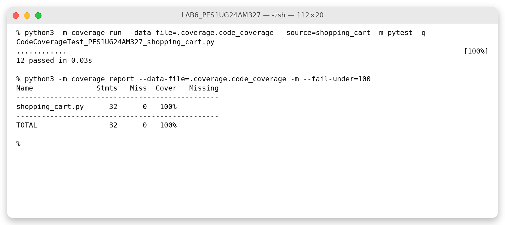
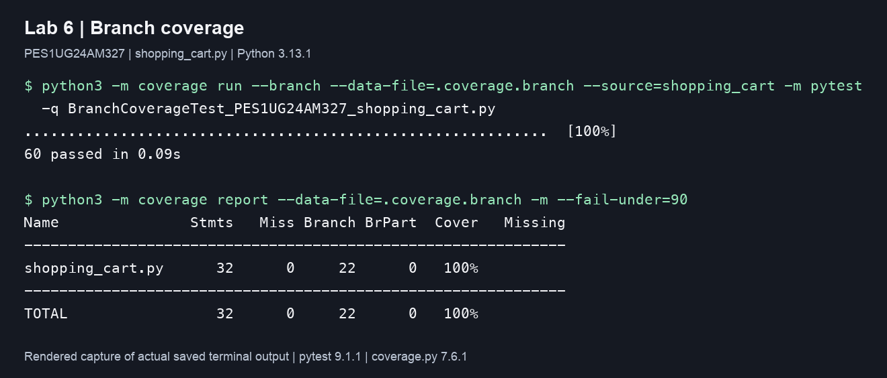

# Lab 6: Code and Branch Coverage Analysis

**Name:** Kundhan Vudutha  
**SRN:** PES1UG24AM327  
**Application:** Shopping Cart

## Application and submission files

The application is taken from the assigned [shopping cart repository](https://github.com/SETAPESU26/L6_L7_23_shopping_cart/tree/main/Lab%206).
`shopping_cart.py` is unchanged from the starter (Git blob
`342dae38d7620e3df2503c772f2c3b4a6b29caf1`). It calculates GST and bulk
discounts, cart discounts, and shipping fees.

| File | Purpose |
| --- | --- |
| `CodeCoverageTest_PES1UG24AM327_shopping_cart.py` | Statement coverage tests; 12 cases |
| `BranchCoverageTest_PES1UG24AM327_shopping_cart.py` | Independent branch and boundary tests; 60 cases |
| `screenshots/code_coverage.png` | Image capture of the final code coverage terminal output |
| `screenshots/branch_coverage.png` | Image capture of the final branch coverage terminal output |
| `reports/` | Original command output and machine-readable coverage reports |
| `pytest.ini` | Enables automatic discovery of the required test filenames |
| `requirements.txt` | Versions used for the test run |

The PNGs are labelled renderings of the saved terminal output. They show the
actual commands and results, with long commands wrapped for readability; they
are not native terminal-window screenshots. The complete original output is
included in the text logs. Only final results above 90% have image captures.

## Running the tests

Use Python 3.13 and run these commands from `LAB6_PES1UG24AM327`:

```sh
python3 -m pip install -r requirements.txt

python3 -m coverage run --data-file=.coverage.code --source=shopping_cart -m pytest -q CodeCoverageTest_PES1UG24AM327_shopping_cart.py
python3 -m coverage report --data-file=.coverage.code -m --fail-under=90

python3 -m coverage run --branch --data-file=.coverage.branch --source=shopping_cart -m pytest -q BranchCoverageTest_PES1UG24AM327_shopping_cart.py
python3 -m coverage report --data-file=.coverage.branch -m --fail-under=90

# Both test suites together:
python3 -m pytest -q
```

`--source=shopping_cart` measures the application only. Separate coverage data
files prevent the two runs from overwriting each other. Both suites run
independently; the branch suite does not import the code coverage suite.

## Coverage results and analysis

| Test suite | Passing cases | Statements executed | Branch outcomes executed | Coverage report |
| --- | ---: | ---: | ---: | ---: |
| Original starter, line mode | 2 | 14/32 (43.75%) | Not measured | 44% |
| Original starter, branch mode | 2 | 14/32 (43.75%) | 6/22 (27.27%) | 37% combined |
| Code coverage suite, line mode | 12 | 32/32 (100%) | Not measured | 100% |
| Code suite measured in branch mode | 12 | 32/32 (100%) | 19/22 (86.36%) | 94% combined |
| Branch coverage suite | 60 | 32/32 (100%) | 22/22 (100%) | 100% combined |

Coverage.py's `Cover` percentage in branch mode combines statements and branch
outcomes. It is not the branch-only percentage. The JSON reports give the
separate counts used above. The final branch suite has no missing statements,
missing branches, partial branches, or excluded statements.

### Code coverage

The starter tests exercised a food item and free standard shipping, leaving
18 executable statements untested. The code coverage suite executes every
statement by testing all GST categories, bulk discount, both validation errors,
all cart discount tiers, Prime benefits, the FLAT10 coupon, and each express
shipping fee calculation.



### Why line coverage alone is insufficient

The 12-case suite reaches 100% statement coverage, but it always uses Prime
with a valid coupon for cart discounts and always requests express shipping.
When measured in branch mode, it misses `22->24` (non-Prime cart), `24->26`
(coupon condition false), and `36->40` (standard shipping). This leaves only
19 of 22 branch outcomes covered, despite every statement having executed.

### Branch coverage

The independent branch suite adds the missing decision outcomes and tests
values below, at, and above the main thresholds:

| Area | Cases covered |
| --- | --- |
| Item validation | Unknown, empty, and differently capitalized categories; negative price; zero/negative quantity; both invalid |
| Item calculation | All three GST categories; quantities 9, 10, 11; zero price; integer rounding |
| Cart discounts | Values around 1000, 2000, and 5000; Prime and non-Prime; valid, absent, wrong, and differently capitalized coupons; stacking and integer rounding |
| Shipping | Values 0, 499, 500, 501 across all Prime/express combinations; original 1000-value free shipping case |

Expected results are literal values checked against the given rules. For
example, 11 food items at 100 give a bulk-discounted amount of 990, then GST
of `990 * 5 // 100 = 49`, for a total of 1039. A Prime cart of 5000 with
FLAT10 gets `500 + 100 + 500 = 1100` discount.

The cases also exercise both operands of the compound validation and coupon
conditions. Coverage.py measures control-flow arcs; 100% reported branch
coverage does not prove complete condition coverage, every possible path, or
correctness for all inputs. The boundary and output assertions provide
additional checks beyond the coverage percentage.



## Commit structure

1. `Lab 6: add code coverage tests and output capture` - application, code
   coverage suite, code coverage result, and its image capture.
2. `Lab 6: add branch coverage tests and output capture` - independent branch
   suite, branch coverage result, its image capture, and this analysis.

The run used Python 3.13.1, pytest 9.1.1, and coverage.py 7.6.1 with the Python
tracer. No application statements were removed or excluded to raise coverage.
